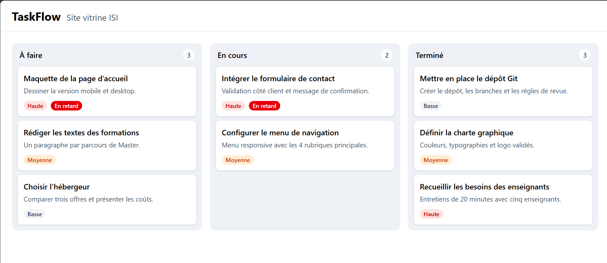

# TaskFlow Teams — J1 · Maquette statique typée

Kanban d'équipe en React 19 + TypeScript (Vite, Tailwind v4).
Ce jalon pose le board statique : 3 colonnes, 8 tâches mockées, sans état.

## Lancer le projet

    npm install
    npm run dev
    npm run build

## Contenu du jalon

- `src/api/types.ts` : types partagés
- `src/data/mockTasks.ts` : 8 tâches sur les 3 statuts
- Composants : Header, Board, Column, TaskCard, PriorityBadge
- Badge « En retard » si `dueDate` est dépassée et la tâche non terminée